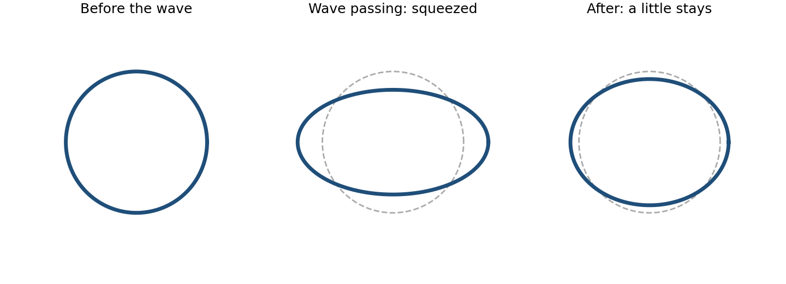
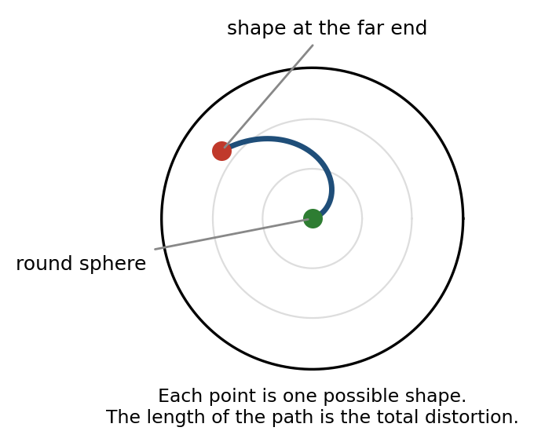

DOI of this text: [doi:10.5281/zenodo.24576187](https://doi.org/10.5281/zenodo.24576187)

This is an introduction to the research paper *Affine length bounds the conformal excursion on a null cone: a sharp focusing inequality* [Per26], by the same author. The paper has the proofs. This note has the idea. No equations are needed to follow it. It makes no claim the paper does not make, and it says which claims are proved and which are only computed.

# A flash of light

Switch on a lamp for an instant. The light spreads out in every direction at once. Picture each ray as a thin thread. Together the threads form a growing sphere of light. Physicists call the whole surface, stretched out through time, a **light cone**.

At first the sphere is perfectly round. Now suppose a gravitational wave passes through. A gravitational wave squeezes space in one direction and stretches it in the other, then reverses. The sphere of light feels it. A round balloon turns into an egg. A moment later it is squeezed the other way.

Some of this distortion fades when the wave has gone. But not all of it. A small part stays. That leftover is called **gravitational memory**: space remembers that a wave went by.

{width=95%}

The question of this paper is simple to ask. **How much can the shape of the light be distorted?**

# One point for every shape

Here is the picture that makes the question easy to handle.

Forget the size of the sphere for a moment and look only at its shape: round, slightly egg-like, very long and thin, and so on. Every possible shape can be given a single address. The set of all addresses is a well-known curved surface called the **hyperbolic plane**. Draw it as a disk. The centre is the perfectly round shape. The farther out a point lies, the more stretched the shape it stands for.

Now follow one ray as it travels outward. At each moment the shape of the light around it is some point on the disk. As the light moves on, the point moves. So the whole trip draws a **path** on the hyperbolic plane.

The length of that path is the total distortion the light has suffered along the way. A short path means the shape barely changed. A long path means it was bent and twisted a lot, even if it ended up near where it began.

{width=55%}

# Gravity sets a clock

Gravity does something to light that matters here: it **focuses** it. Rays that start out side by side are pulled toward each other. Given enough room, they cross. When rays cross, the cone stops making sense as a smooth surface at that spot.

So a cone cannot run forever. There is a limit to how far it can go before its rays start to cross. We call that reach its **clock**. A cone with a long clock can travel a long way. A cone with a short clock has little time before it breaks down.

There is a catch, and it is the heart of the matter. Twisting the shape costs something. The more the shape is distorted along the way, the more the rays are focused, and the sooner they cross. Distortion eats the clock.

# The result: an exact limit

Put the two ideas together and you get a trade. Distortion shortens the clock, so for a given clock there is a ceiling on how much distortion is possible.

The paper gives that ceiling **exactly**. For a given clock, there is one precise number: the largest total distortion a cone can have. The paper writes it as a closed formula, and it proves three things about it.

- **It is a true limit.** No cone beats it.
- **It cannot be improved.** Nothing smaller works as a limit for all cones. The formula is the best possible.
- **One extreme case reaches it.** There is exactly one way to come as close as you like to the ceiling. It is a path where the shape changes fastest when the rays have the least distance left to run. Each stretch of the path is done at a speed set by the distance still to go.

Turn the statement around and it reads like a rule of thumb. **A big memory needs a long clock.** If a wave leaves a large permanent distortion, the cone that carries it must be able to run a long way before its rays cross. A short cone simply cannot hold a large distortion.

The first version of the result is for **one ray**: follow a single thread and bound its path. A second result, for the **whole cone** at once, is also proved. It averages the distortion over all the rays of the cone, and it contains the older, classical bound on the area of the cone as the special case where there is no distortion at all. Whenever there is some distortion, the new bound is stronger.

{width=80%}

# What is new

The setting comes from a recent paper by Chandrasekaran [Cha26] on a quantum-gravity approach. That paper already asks for a bound of this kind, because it needs one. It has a rough version, which was never meant to be sharp. Our paper replaces the rough version with the exact one and checks what follows. All of this is **proved**, unless stated otherwise.

- **The exact formula.** The best possible limit, in closed form, with its unique extreme case. At a clock of 2 and a starting size of one part in a thousand, the rough version allows about **16 times** more distortion than the truth. (This is read from a table in the paper, computed from the exact formula.)
- **The small-excess law.** For a clock only slightly above the minimum, the allowed distortion shrinks in a simple, explicit way.
- **The whole-cone version.** The bound for all rays together, as described above.
- **A necessary logarithm.** The source paper bounds the distortion over a patch of the cone, and its bound grows like a logarithm. We prove that this logarithm cannot be avoided: no correct bound on a patch can grow more slowly. This is proved.
- **A prefactor that looks too loose, by computer.** The same patch bound also carries a large leading factor. Our computations say that factor is too loose by about **9**, **54** and **370 times**, when the small starting size is 0.1, 0.01 and 0.001. This part is **computed only**. It rests on a large-clock law that fits the numbers very well but is not proved, and the paper labels it that way.
- **A gap in a side check.** The source paper includes a one-loop consistency check. One sentence in it does not follow from the clock alone, and we give an explicit family of cones that shows why. We are careful about what this says. It is a gap in a sentence of a side check. It is **not** a counterexample to the source paper's main finiteness argument, and we do not claim the sentence is false, only that the stated reason is not enough.
- **Any dimension.** The same bound holds for spacetimes with more than three space dimensions, with a simple change of constant that depends on the dimension.
- **Matter.** The bound still works when matter is present. Matter that carries energy through the cone uses up part of the clock, and the distortion shares what is left. This is sharp in each of its two parts taken separately. It is not claimed to be sharp for both together, and the paper says so.

# Why it matters

The quantum-gravity approach of the source paper depends on certain quantities staying finite. To show that, one needs numbers, not just words like "bounded". The exact limit gives those numbers. A sharper bound means a more honest picture of how safe the finiteness argument is, and the same sharper bound can be reused elsewhere.

There is a cleaner reading too. The result is a **focusing inequality**: a clear statement of how gravity's pull on light limits how much a beam can change its shape. Focusing is one of the oldest ideas in general relativity. Here it gets an exact, quantitative form.

Finally, the core of the main theorem, the inequality that the whole formula rests on, has been **checked by computer in Lean**, a program that verifies a proof line by line. It is the only part formalised so far, and the standard Lean axioms are all it uses. The rest of the paper is checked the usual way, by proof and by independent numerical computation.

# What this note does not do

It does not prove anything. If you want to see why the formula is exactly right, the proofs are in the paper. It also does not say more than the paper does: every item above marked proved is proved there, and the one item marked computed is computed there.

# Where to go next

- The paper itself [Per26], with the proofs.
- The source of the setting [Cha26].
- The geometric view of light and the hyperbolic plane used here comes from Jason Glowney's *Arithmoí*, Book 1 [Glo23].

# Acknowledgements {-}

We are grateful to Jason Glowney, whose geometric treatment of light, the light cone and hyperbolic curvature in *Arithmoí*, Book 1, led us to the hyperbolic-plane view of null data on which the paper is built.

# References {-}

[Cha26] V. Chandrasekaran, *An algebraic quantization of gravity from the null cone*, 2026, [arXiv:2611.34924](https://arxiv.org/abs/2611.34924).

[Glo23] J. Glowney, *Arithmoí: A Study of Mathematical Cohesiveness in Physics and Metaphysics*, Book 1, First Edition, Athene Noctua, 2023.

[Per26] M. Perreault, *Affine length bounds the conformal excursion on a null cone: a sharp focusing inequality*, 2026, Zenodo. [doi:10.5281/zenodo.24572220](https://doi.org/10.5281/zenodo.24572220).

# Use of AI {-}

Claude (Anthropic) was used in November 2026, under the author's direction, for exploratory computation, derivations, code, checks, literature search and drafting.

# Read the research paper {-}

```{=latex}
\raggedright
```

The full paper, with the proofs, is *Affine length bounds the conformal excursion on a null cone: a sharp focusing inequality*, by Michaël Perreault.

DOI: [doi:10.5281/zenodo.24572220](https://doi.org/10.5281/zenodo.24572220)
